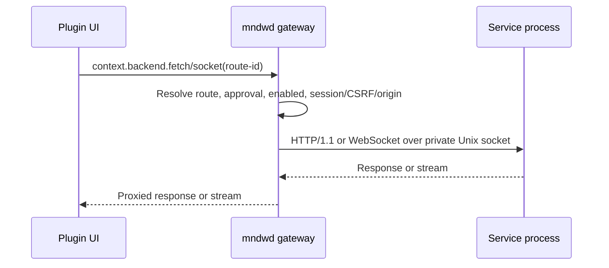

# Service backends

## Choose a backend

> Decision guidance — this section helps choose an execution model; it is not
> part of the service wire contract.

Choose `service` when a plugin needs resident state, polling, a device session, or WebSockets.
Choose [`exec`](plugin-author-guide.md#write-a-shell-endpoint)
when each HTTP request is independent and should start a fresh process. The exec response path is
CGI-like; see
[`cgi.go`](../daemon/mndwd/internal/backend/cgi.go) for its implementation.

The rest of this page defines the `service` contract.

`mndwd` owns process startup, authorization, readiness, routing, limits, restart, and shutdown. Your
process owns application routes and domain state. Approval is a privileged code-execution boundary:
approved service code runs with daemon/device privileges.

## Declare the service in `manifest.json`

Declare one foreground command and one or more HTTP/WebSocket routes:

```json
{
  "manifestVersion": 3,
  "name": "service-example",
  "version": "1.0.0",
  "type": "page",
  "label": "Service example",
  "entry": "index.js",
  "route": "/service-example",
  "backend": {
    "kind": "service",
    "protocolVersion": 1,
    "command": "backend/server",
    "args": [
      "--foreground"
    ],
    "packages": [
      "example-package"
    ],
    "routes": [
      {
        "id": "status",
        "transport": "http",
        "method": "GET",
        "path": "status"
      },
      {
        "id": "terminal",
        "transport": "websocket",
        "path": "terminal",
        "protocols": [
          "tty"
        ]
      }
    ]
  }
}
```

`command` is a safe relative path to an executable inside the plugin. `args`
are literal arguments. `packages` names device packages installed during approval. Route paths are
relative and do not include the public plugin prefix. Route IDs are what frontend code uses.

Routes use session access by default. A public HTTP route must be `GET` or
`HEAD`; public access never bypasses approval or enabled state. Service routes may use `http` or
`websocket`. The manifest model and validation rules are in
[`manifest.ts`](../frontend/sdk/src/manifest.ts), and the complete service fixture is [
`backend-service-v3.json`](../frontend/sdk/fixtures/manifests/valid/backend-service-v3.json).

## Request flow



The SDK resolves route IDs from a descriptor snapshot. `mndwd` repeats authorization because
approval or enabled state can change after that snapshot was loaded.

## `mndwd` <-> service contract

Contract details below link to their current implementation. The Go integration fixture is the
tested reference for startup, readiness, routing, and cleanup.

### Process startup and environment

`mndwd` validates the command path, starts it in the plugin directory, and keeps it in the
foreground. The child receives an allowlisted environment, not the daemon's complete environment.
The environment is assembled in
[`environment.go`](../daemon/mndwd/internal/backend/environment.go):

| Variable                  | Meaning                                                                              |
|---------------------------|--------------------------------------------------------------------------------------|
| `MNDW_PLUGIN_ID`          | Manifest plugin name.                                                                |
| `MNDW_PLUGIN_DIR`         | Installed plugin directory and process working directory.                            |
| `MNDW_PLUGIN_DATA_DIR`    | Per-plugin persistent data directory.                                                |
| `MNDW_PLUGIN_RUNTIME_DIR` | Disposable per-plugin runtime directory.                                             |
| `MNDW_BACKEND_SOCKET`     | Daemon-selected Unix-socket path; required for services.                             |
| `MNDW_BACKEND_PROTOCOL`   | Manifest `protocolVersion`; readiness must echo it.                                  |
| `MNDW_RCI_SESSION_SOCKET` | Optional daemon-owned persistent-RCI socket when the plugin declares the permission. |

`PATH` is also supplied. Do not daemonize, create a PID file, choose another socket, or bind a
public TCP listener. The service command must stay attached to the process group that `mndwd`
supervises.

### Unix socket and readiness

The default device runtime root is
`/opt/tmp/mndw/plugin-runtime/<plugin-id>`, with `backend.sock` as the service socket. The daemon
creates runtime directories with mode `0700`, removes stale socket and lease evidence, and owns
process identity and cleanup. See
[`paths.go`](../daemon/mndwd/internal/backend/paths.go) and
[`supervisor.go`](../daemon/mndwd/internal/backend/supervisor.go).

The child must:

1. Read `MNDW_BACKEND_SOCKET`.
2. Listen on that Unix socket and serve HTTP/1.1.
3. Register `GET /_mndw/ready`.
4. Return HTTP `200` with a JSON object whose `pluginId` equals
   `MNDW_PLUGIN_ID` and whose `protocolVersion` equals
   `MNDW_BACKEND_PROTOCOL`.
5. Keep serving after the readiness response.

`/_mndw/ready` is reserved for the daemon and is not a manifest route. The daemon retries connection
failures and uses a default 30-second readiness timeout. The exact probe is in
[`readiness.go`](../daemon/mndwd/internal/backend/readiness.go); the tested fixture's handler is in
[`service-helper/main.go`](../daemon/mndwd/internal/backend/testdata/service-helper/main.go).

### HTTP routes

For a manifest route such as `path: "status"`:

- browser URL: `/api/plugins/<plugin-name>/status`;
- child URL: `/status`, with the browser query string preserved.

Before proxying, the gateway resolves the route, checks approval and enabled state, authenticates
private routes, and requires CSRF for unsafe private HTTP methods. It then forwards the method,
query, bounded body, and selected request headers. It adds these daemon-owned headers:

```text
X-Mndw-Plugin-Id: <manifest plugin name>
X-Mndw-Route-Id: <manifest route id>
```

Selected representation and cache headers, range information, and
`User-Agent` may reach the child. The exhaustive request allowlist is in
[`proxy.go`](../daemon/mndwd/internal/backend/proxy.go). Do not rely on cookies, `Authorization`,
`X-Mndw-Csrf`, arbitrary browser headers, or CORS headers reaching the child; pass application data
explicitly in the declared query or body when needed.

The default service HTTP timeout is 30 seconds and the default request-body limit is 1 MiB. The
daemon filters CORS, hop-by-hop, `Set-Cookie`, and
`Content-Length` response headers and sets `Cache-Control: no-store`. See
[`gateway.go`](../daemon/mndwd/internal/backend/gateway.go),
[`proxy.go`](../daemon/mndwd/internal/backend/proxy.go), and
[`headers.go`](../daemon/mndwd/internal/backend/headers.go) for the current limits and filters.

### WebSocket routes

For a WebSocket route such as `path: "terminal"`:

- browser URL: `/ws/plugins/<plugin-name>/terminal`;
- the query string is preserved;
- `mndwd` checks Origin, enabled/approval state, private session access when applicable, and
  declared subprotocols before connecting to the child;
- the same route path is proxied over the private Unix socket.

If maintenance or an update closes an existing browser socket, the gateway uses close code `1012`and
reason `mndw updating`. Show an explicit reconnect action; do not silently recreate a session.
Origin and route proxy behavior are implemented in [
`origin.go`](../daemon/mndwd/internal/backend/origin.go)
and [`gateway.go`](../daemon/mndwd/internal/backend/gateway.go).

### Optional diagnostics endpoint

`GET /_mndw/diagnostics` is optional and daemon-invoked. It is not a manifest route and is not
exposed directly to plugin browser code. If you implement it, return:

```text
HTTP 200
Content-Type: application/json
body: one JSON object, no trailing JSON, at most 256 KiB
```

There are no required member names. Return bounded, non-sensitive diagnostic data, for example
counters or current application state. The daemon calls the endpoint only while the service is
ready, applies a two-second request bound, and rejects non-JSON, non-object, trailing, or oversized
responses. The child response validation is in
[`backend/diagnostics.go`](../daemon/mndwd/internal/backend/diagnostics.go).

The daemon's aggregate diagnostics response wraps valid service data as
`live: {"status":"available","data":{...}}`. Unavailable or invalid data becomes
`live.status: "unavailable"` with a bounded reason. The aggregate response also bounds total data
and redacts sensitive keys and values. See
[`internal/diagnostics/diagnostics.go`](../daemon/mndwd/internal/diagnostics/diagnostics.go).

### Limits and timeouts

These are current defaults. Configuration fields can override several of them. Some values are named
Go constants; others are fallback expressions in constructors or call sites. The table keeps the
exact symbol/expression so a source review can verify each value quickly.

| Scope                               |                Default | Go constant, field, or expression                                                 | Source                                                                                                                                         |
|-------------------------------------|-----------------------:|-----------------------------------------------------------------------------------|------------------------------------------------------------------------------------------------------------------------------------------------|
| Total concurrent exec requests      |                      8 | `Limits.MaxConcurrentExecTotal`; `NewRuntime` fallback `8`                        | [`runtime.go`](../daemon/mndwd/internal/backend/runtime.go)                                                                                    |
| Concurrent exec requests per plugin |                      4 | `Limits.MaxConcurrentExecPerPlugin`; `NewRuntime` fallback `4`                    | [`runtime.go`](../daemon/mndwd/internal/backend/runtime.go)                                                                                    |
| Supervised services                 |                      8 | `Limits.MaxSupervisedServices`; `NewRuntime`/`NewSupervisor` fallback `8`         | [`runtime.go`](../daemon/mndwd/internal/backend/runtime.go), [`supervisor.go`](../daemon/mndwd/internal/backend/supervisor.go)                 |
| HTTP request body                   |                  1 MiB | `GatewayConfig.MaxRequestBytes`; `NewGateway` fallback `1 << 20`                  | [`gateway.go`](../daemon/mndwd/internal/backend/gateway.go)                                                                                    |
| Service HTTP request                |                   30 s | `GatewayConfig.ServiceHTTPTimeout`; `NewGateway` fallback `30 * time.Second`      | [`gateway.go`](../daemon/mndwd/internal/backend/gateway.go)                                                                                    |
| Readiness                           |                   30 s | `SupervisorConfig.ReadinessTimeout`; `NewSupervisor` fallback `30 * time.Second`  | [`supervisor.go`](../daemon/mndwd/internal/backend/supervisor.go), [`runtime.go`](../daemon/mndwd/internal/backend/runtime.go)                 |
| Service diagnostics request         |                    2 s | `SupervisorConfig.DiagnosticsTimeout`; `NewSupervisor` fallback `2 * time.Second` | [`supervisor.go`](../daemon/mndwd/internal/backend/supervisor.go), [`backend/diagnostics.go`](../daemon/mndwd/internal/backend/diagnostics.go) |
| Child diagnostics response          |                256 KiB | `defaultLiveDiagnosticsBytes = 256 * 1024`                                        | [`backend/diagnostics.go`](../daemon/mndwd/internal/backend/diagnostics.go)                                                                    |
| Aggregate diagnostics per plugin    |                256 KiB | `defaultMaxPluginBytes = 256 * 1024`                                              | [`diagnostics.go`](../daemon/mndwd/internal/diagnostics/diagnostics.go)                                                                        |
| Aggregate diagnostics total         |                  1 MiB | `defaultMaxTotalPluginBytes = 1024 * 1024`                                        | [`diagnostics.go`](../daemon/mndwd/internal/diagnostics/diagnostics.go)                                                                        |
| WebSocket read buffer               |                 32 MiB | `SetReadLimit(32 << 20)`                                                          | [`gateway.go`](../daemon/mndwd/internal/backend/gateway.go)                                                                                    |
| Graceful service stop               |                   10 s | `SupervisorConfig.StopTimeout`; `NewSupervisor` fallback `10 * time.Second`       | [`supervisor.go`](../daemon/mndwd/internal/backend/supervisor.go), [`runtime.go`](../daemon/mndwd/internal/backend/runtime.go)                 |
| Final service reap                  |                    2 s | `SupervisorConfig.FinalReapTimeout`; `NewSupervisor` fallback `2 * time.Second`   | [`supervisor.go`](../daemon/mndwd/internal/backend/supervisor.go), [`runtime.go`](../daemon/mndwd/internal/backend/runtime.go)                 |
| Restart delay                       |      1 s, then doubles | `time.Second << (consecutiveFailures - 1)`                                        | [`supervisor.go`](../daemon/mndwd/internal/backend/supervisor.go)                                                                              |
| Failure threshold                   | 5 consecutive failures | `ConsecutiveFailures >= 5`                                                        | [`supervisor.go`](../daemon/mndwd/internal/backend/supervisor.go)                                                                              |

### Shutdown, restart, and failure states

The lifecycle state names come from
[`model.go`](../daemon/mndwd/internal/backend/model.go); transitions and supervision are implemented
in
[`supervisor.go`](../daemon/mndwd/internal/backend/supervisor.go) and exposed through [
`runtime.go`](../daemon/mndwd/internal/backend/runtime.go).

| State              | Meaning                                                                                                          |
|--------------------|------------------------------------------------------------------------------------------------------------------|
| `stopped`          | No service process is running.                                                                                   |
| `capacity_blocked` | Service is enabled but the shared supervised-service limit is full.                                              |
| `starting`         | Process started; readiness has not completed.                                                                    |
| `ready`            | Readiness identity matched and routes can be proxied.                                                            |
| `backoff`          | Startup or unexpected exit failed; retry is scheduled.                                                           |
| `failed`           | Repeated failures reached the supervisor's failure threshold; inspect runtime diagnostics or restart explicitly. |

Unsupported `protocolVersion` values remain represented in management state but do not start;
requests receive `BACKEND_INCOMPATIBLE`. While a service is starting or backing off, requests
receive a service-unavailable response and may include `Retry-After`. Unexpected exits use bounded
exponential retry; repeated failures reach `failed`.

Disable, delete, update, maintenance, and daemon shutdown stop the supervised process group and
remove socket/lease evidence. The child should handle
`SIGTERM`, stop accepting new work, close listeners, and persist only intentional application state.
It must not depend on a separate reaper.

## Implement the service

### Tested Go reference

The complete tested reference is
[`service-helper/main.go`](../daemon/mndwd/internal/backend/testdata/service-helper/main.go).
[`runtime_integration_test.go`](../daemon/mndwd/internal/backend/runtime_integration_test.go)
builds that helper, waits for readiness, routes an HTTP request through the gateway, and verifies
socket/lease cleanup. Use it as the source-backed reference; its descendant process and diagnostics
payload are test fixtures, not requirements for production services.

The core pattern is:

```go
socketPath := os.Getenv("MNDW_BACKEND_SOCKET")
listener, err := net.Listen("unix", socketPath)
if err != nil {
    log.Fatal(err)
}
defer listener.Close()

mux := http.NewServeMux()
mux.HandleFunc("GET /_mndw/ready", ready)
mux.HandleFunc("GET /status", status)
server := &http.Server{Handler: mux}
log.Fatal(server.Serve(listener))
```

Production code should remove an old socket only when it has established that the path is its own
stale runtime evidence, restrict socket permissions, bound request bodies at endpoint boundaries,
and shut down on `SIGTERM`. The built-in
[`ping-widget` service](../plugins/builtin/ping-widget/backend/internal/httpapi/server.go)
shows JSON HTTP routes; the
[`terminal-page` service](../plugins/builtin/terminal-page/backend/internal/server/server.go)
shows HTTP plus WebSocket proxying.

### Other languages

Go is used by current built-in and integration services, but the contract is language-neutral. Any
runtime that can execute the declared command, listen on the supplied Unix socket, serve HTTP/1.1,
implement readiness, and honor `SIGTERM` can implement a service.

## Call the service from a plugin

The browser API below is implemented by
[`backend-client.ts`](../frontend/sdk/src/backend-client.ts). It resolves declared route IDs, builds
the `/api/plugins/...` or `/ws/plugins/...` URL, injects CSRF for unsafe HTTP methods, serializes
plain JSON bodies, and maps daemon approval errors to typed SDK errors. Do not assemble daemon URLs
by hand:

```ts
const status = await context.backend?.fetch('status', {
  query: {detail: 'summary'},
})
const payload = await status?.json()

const terminal = context.backend?.socket('terminal')
terminal?.addEventListener('message', (event) => {
  // Handle the declared WebSocket protocol.
})
```

The SDK reports `BackendUnknownId`, `BackendNotApproved`,
`BackendDisabled`, and transport mismatch errors. The daemon repeats its own checks if plugin state
changes after the host descriptor was loaded. Use
`isBackendMaintenanceClose(event)` from the same SDK module to recognize close code `1012` with
reason `mndw updating` and show explicit reconnect UX.

## Security and production checklist

### `mndwd` already enforces

| Guarantee                                                                | Source                                                                                                                                                 |
|--------------------------------------------------------------------------|--------------------------------------------------------------------------------------------------------------------------------------------------------|
| Approval/enabled/session checks and route method/transport matching      | [`gateway.go`](../daemon/mndwd/internal/backend/gateway.go), management/authz paths                                                                    |
| Private WebSocket Origin validation and declared subprotocol negotiation | [`origin.go`](../daemon/mndwd/internal/backend/origin.go), [`gateway.go`](../daemon/mndwd/internal/backend/gateway.go)                                 |
| Request-body, admission, and service-timeout limits                      | [`gateway.go`](../daemon/mndwd/internal/backend/gateway.go), [`limits.go`](../daemon/mndwd/internal/backend/limits.go)                                 |
| CORS, hop-by-hop, credential response filtering, and `no-store`          | [`headers.go`](../daemon/mndwd/internal/backend/headers.go), [`proxy.go`](../daemon/mndwd/internal/backend/proxy.go)                                   |
| Bounded stderr capture/redaction and aggregate diagnostics sanitization  | [`stderr_redaction.go`](../daemon/mndwd/internal/backend/stderr_redaction.go), [`diagnostics.go`](../daemon/mndwd/internal/diagnostics/diagnostics.go) |
| Process groups, restart/backoff, and runtime socket/lease cleanup        | [`supervisor.go`](../daemon/mndwd/internal/backend/supervisor.go), [`runtime.go`](../daemon/mndwd/internal/backend/runtime.go)                         |

### The author must implement or review

| Area                         | Required action                                                                                                                                          |
|------------------------------|----------------------------------------------------------------------------------------------------------------------------------------------------------|
| Socket, readiness, lifecycle | Bind the supplied Unix socket, return matching readiness identity, stay foreground, and handle `SIGTERM`.                                                |
| Endpoint input/output        | Validate request data, apply tighter per-endpoint limits when needed, return intentional status/content types, and avoid secrets in bodies/logs.         |
| Manifest capability          | Review every command, package, route, method, public exposure, and permission before approval.                                                           |
| Application security         | Do not assume cookies, authorization, CSRF, or arbitrary browser headers reach the child; authenticate or authorize application-specific data as needed. |
| WebSocket UX                 | Handle `1012` / `mndw updating` with explicit reconnect UI; never silently resume a session.                                                             |

Daemon safeguards do not replace service-level input validation, domain authorization, or secret
hygiene.

## Verify locally

Run the normal author loop from the plugin directory:

```bash
mndw validate .
mndw pack .
mndw zip .
```

Then check service-specific behavior:

1. Confirm the packed command exists, is executable, and is declared by the manifest.
2. Start the service with the required environment variables and verify
   `GET /_mndw/ready` returns matching `pluginId` and `protocolVersion`.
3. Exercise every declared HTTP route through `context.backend.fetch`.
4. Exercise every declared WebSocket route through `context.backend.socket`, including its declared
   subprotocol.
5. Test SIGTERM, restart, and explicit reconnect behavior.

For the daemon contract itself, the focused backend test builds and runs the tested helper:

```bash
GOCACHE="$PWD/.cache/go-build" go test ./daemon/mndwd/internal/backend
```
