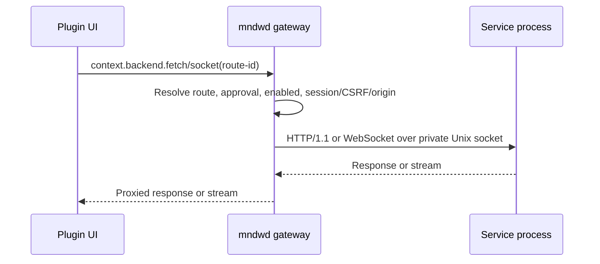

# Service-бэкенды

[English](service-backend.md) | **Русский**

## Выберите бэкенд

> Рекомендации по выбору — этот раздел помогает выбрать модель выполнения и не является частью
> wire-контракта service.

Выбирайте `service`, если плагину нужны постоянное состояние, polling, сессия устройства или
WebSocket. Выбирайте [`exec`](plugin-author-guide.ru.md#напишите-shell-endpoint), если каждый
HTTP-запрос независим и должен запускать новый процесс. Путь ответа exec — CGI-подобный; его
реализация описана в [`cgi.go`](../daemon/mndwd/internal/backend/cgi.go).

Остальная часть страницы определяет контракт `service`.

`mndwd` владеет запуском процессов, авторизацией, готовностью, маршрутизацией, лимитами,
перезапуском и выключением. Ваш процесс владеет маршрутами приложения и предметным состоянием.
Approval — привилегированная граница выполнения кода: одобренный код service работает с
привилегиями демона/устройства.

## Объявите service в `manifest.json`

Объявите одну foreground-команду и один или несколько HTTP/WebSocket-маршрутов:

```json
{
  "manifestVersion": 1,
  "name": "service-example",
  "version": "1.0.0",
  "type": "page",
  "label": "Service example",
  "entry": "index.js",
  "route": "/service-example",
  "backend": {
    "kind": "service",
    "protocolVersion": 1,
    "command": "backend/server",
    "args": [
      "--foreground"
    ],
    "packages": [
      "example-package"
    ],
    "routes": [
      {
        "id": "status",
        "transport": "http",
        "method": "GET",
        "path": "status"
      },
      {
        "id": "terminal",
        "transport": "websocket",
        "path": "terminal",
        "protocols": [
          "tty"
        ]
      }
    ]
  }
}
```

`command` — безопасный относительный путь к исполняемому файлу внутри плагина. `args` —
буквальные аргументы. `packages` — имена пакетов устройства, устанавливаемых во время approval.
Пути маршрутов относительные и не содержат публичный префикс плагина. Route ID используются
фронтенд-кодом.

По умолчанию маршруты используют session access. Публичный HTTP-маршрут должен быть `GET` или
`HEAD`; public access не отменяет approval или enabled state. Service-маршруты могут использовать
`http` или `websocket`. Модель манифеста и правила проверки находятся в
[`manifest.ts`](../frontend/sdk/src/manifest.ts), а полная фикстура service — в
[`backend-service.json`](../contracts/manifest/fixtures/valid/backend-service.json).

## Поток запроса



SDK разрешает route ID из снимка дескриптора. `mndwd` повторяет авторизацию, поскольку approval
или enabled state могли измениться после загрузки снимка.

## Запросите актуальное состояние бэкенда

Плагины с клиентом бэкенда могут запросить актуальное состояние демона, не выполняя маршрут:

```ts
const status = await context.backend?.status({signal});

if (status?.state === 'blocked') {
  for (const blocker of status.blockers) {
    // Use blocker.reason and blocker.prerequisite as machine-readable codes.
  }
}
```

`status()` всегда выполняет аутентифицированный актуальный запрос к
`GET /api/plugins/<plugin-name>/_mndw/status`. Он пассивен, привязан к имени плагина клиента,
никогда не запускает команду и не возвращает диагностические данные управления. Ответ с
не-2xx или некорректная структура отклоняются с `BackendStatusQueryError`; ошибки отмены и
сети сохраняют исходные ошибки. Это не замена ошибкам запросов `fetch()` или `socket()`.

Состояния:

| State | Meaning |
| --- | --- |
| `ready` | Запросы могут быть допущены; следующий запрос всё ещё может завершиться ошибкой. |
| `starting` | Service запускается или повторяет запуск; может присутствовать `retryAfterSeconds`. |
| `unavailable` | Service остановлен или неисправен. |
| `incompatible` | Протокол service не поддерживается; поля протокола присутствуют. |
| `maintenance` | Активно обслуживание платформы или плагина. |
| `blocked` | Разрешение или prerequisite для активации service недоступны. |
| `disabled` | Плагин отключён. |
| `not-approved` | Approval плагина не завершён. |

`blocked` содержит непустой `blockers` в порядке разрешений манифеста. Строки reason и
prerequisite — открытые машиночитаемые коды; потребители должны сохранять неизвестные значения.
`incompatible` содержит `requiredProtocol` и `supportedProtocols`. Будущее время повторной
попытки округляет оставшуюся длительность вверх до целых секунд. Отсутствующий, равный
текущему или истёкший timestamp даёт `null`.

Бэкенды exec сообщают `ready` после проверок lifecycle и maintenance, поскольку activation gates
планируют постоянные сервисы и не ограничивают путь exec-запроса. `ready` для exec не гарантирует
корректность входных данных команды, окружения или выполнения.

## Контракт `mndwd` ↔ service

Детали контракта ниже ссылаются на текущую реализацию. Go integration fixture — проверенный
эталон запуска, готовности, маршрутизации и очистки.

### Запуск процесса и окружение

`mndwd` проверяет путь команды, запускает её в каталоге плагина и оставляет в foreground.
Дочерний процесс получает allowlist окружения, а не полное окружение демона. Окружение собирается
в [`environment.go`](../daemon/mndwd/internal/backend/environment.go):

| Variable                  | Meaning                                                                              |
|---------------------------|--------------------------------------------------------------------------------------|
| `MNDW_PLUGIN_ID`          | Имя плагина из манифеста.                                                            |
| `MNDW_PLUGIN_DIR`         | Установленный каталог плагина и рабочий каталог процесса.                            |
| `MNDW_PLUGIN_DATA_DIR`    | Постоянный каталог конкретного плагина.                                              |
| `MNDW_PLUGIN_RUNTIME_DIR` | Временный runtime-каталог конкретного плагина.                                       |
| `MNDW_BACKEND_SOCKET`     | Выбранный демоном путь Unix-сокета; обязателен для service.                          |
| `MNDW_BACKEND_PROTOCOL`   | `protocolVersion` манифеста; readiness должен вернуть это значение.                  |
| `MNDW_RCI_SESSION_SOCKET` | Необязательный постоянный RCI-сокет демона, если плагин объявляет это разрешение.     |

Также передаётся `PATH`. Не переходите в daemonize, не создавайте PID-файл, не выбирайте другой
сокет и не привязывайтесь к публичному TCP listener. Команда service должна оставаться
присоединённой к группе процессов, которой управляет `mndwd`.

### Unix-сокет и готовность

Каталог runtime устройства по умолчанию — `/opt/tmp/mndw/plugin-runtime/<plugin-id>`, а сокет
service — `backend.sock`. Демон создаёт runtime-каталоги с режимом `0700`, удаляет устаревшие
признаки сокета и lease, а также владеет идентичностью процесса и очисткой. См.
[`paths.go`](../daemon/mndwd/internal/backend/paths.go) и
[`supervisor.go`](../daemon/mndwd/internal/backend/supervisor.go).

Дочерний процесс обязан:

1. Прочитать `MNDW_BACKEND_SOCKET`.
2. Слушать этот Unix-сокет и обслуживать HTTP/1.1.
3. Зарегистрировать `GET /_mndw/ready`.
4. Вернуть HTTP `200` с JSON-объектом, в котором `pluginId` равен `MNDW_PLUGIN_ID`, а
   `protocolVersion` равен `MNDW_BACKEND_PROTOCOL`.
5. Продолжить обслуживание после ответа readiness.

`/_mndw/ready` зарезервирован демоном и не является маршрутом манифеста. Демон повторяет
подключение при сбоях и использует тайм-аут готовности 30 секунд по умолчанию. Точная проверка
находится в [`readiness.go`](../daemon/mndwd/internal/backend/readiness.go); обработчик тестовой
фикстуры — в [`service-helper/main.go`](../daemon/mndwd/internal/backend/testdata/service-helper/main.go).

### HTTP-маршруты

Для маршрута манифеста, например `path: "status"`:

- URL браузера: `/api/plugins/<plugin-name>/status`;
- URL дочернего процесса: `/status`, query string браузера сохраняется.

До проксирования шлюз разрешает маршрут, проверяет approval и enabled state, аутентифицирует
приватные маршруты и требует CSRF для небезопасных приватных HTTP-методов. Изменения управления
используют тот же фиксированный заголовок `X-Mndw-Csrf: 1` в middleware управления с проверкой
сессии. Затем шлюз передаёт method, query, ограниченное тело и выбранные заголовки запроса.
Он добавляет следующие заголовки, принадлежащие демону:

```text
X-Mndw-Plugin-Id: <manifest plugin name>
X-Mndw-Route-Id: <manifest route id>
```

Выбранные заголовки представления и кэширования, информацию о диапазоне и `User-Agent` можно
передать дочернему процессу. Полный allowlist запросов находится в [`proxy.go`](../daemon/mndwd/internal/backend/proxy.go).
Не полагайтесь на cookies, `Authorization`, `X-Mndw-Csrf`, произвольные заголовки браузера или
CORS, дошедшие до дочернего процесса; при необходимости явно передавайте данные приложения в
объявленном query или body.

Стандартный HTTP timeout service — 30 секунд, стандартный лимит тела запроса — 1 MiB. Демон
фильтрует CORS, hop-by-hop, `Set-Cookie` и `Content-Length` в ответе и устанавливает
`Cache-Control: no-store`. См. [`gateway.go`](../daemon/mndwd/internal/backend/gateway.go) и
[`proxy.go`](../daemon/mndwd/internal/backend/proxy.go) с текущими лимитами и фильтрами.

### WebSocket-маршруты

Для WebSocket-маршрута, например `path: "terminal"`:

- URL браузера: `/ws/plugins/<plugin-name>/terminal`;
- query string сохраняется;
- `mndwd` проверяет Origin, enabled/approval state, private session access при необходимости
  и объявленные subprotocols до подключения к дочернему процессу;
- тот же путь маршрута проксируется через приватный Unix-сокет.

Если обслуживание или обновление закрывает существующий браузерный socket, шлюз использует код
закрытия `1012` и причину `mndw updating`. Покажите явное действие переподключения; не создавайте
сессию заново молча. Поведение Origin и proxy-маршрутов реализовано в
[`origin.go`](../daemon/mndwd/internal/backend/origin.go) и
[`gateway.go`](../daemon/mndwd/internal/backend/gateway.go).

### Необязательный endpoint диагностики

`GET /_mndw/diagnostics` — необязательный endpoint, вызываемый демоном. Это не маршрут
манифеста, и он напрямую не виден браузерному коду плагина. Если вы его реализуете, возвращайте:

```text
HTTP 200
Content-Type: application/json
body: one JSON object, no trailing JSON, at most 256 KiB
```

Обязательных имён членов нет. Возвращайте ограниченные нечувствительные данные диагностики,
например счётчики или текущее состояние приложения. Демон вызывает endpoint только пока service
готов, применяет ограничение запроса в две секунды и отклоняет не-JSON, не-объект, завершающий
мусор или слишком большой ответ. Проверка ответа дочернего процесса находится в
[`backend/diagnostics.go`](../daemon/mndwd/internal/backend/diagnostics.go).

Сводный ответ диагностики демона оборачивает корректные данные service как
`live: {"status":"available","data":{...}}`. Недоступные или некорректные данные становятся
`live.status: "unavailable"` с ограниченной причиной. Сводный ответ также ограничивает общий
объём данных и удаляет чувствительные ключи и значения. См.
[`internal/diagnostics/diagnostics.go`](../daemon/mndwd/internal/diagnostics/diagnostics.go).

### Лимиты и тайм-ауты

Это текущие значения по умолчанию. Поля конфигурации могут переопределять некоторые из них.
Часть значений — именованные константы Go, остальные — fallback-выражения в конструкторах или
местах вызова. В таблице сохраняются точные символы/выражения, чтобы быстро проверить каждое
значение по исходному коду.

| Scope                               |                Default | Go constant, field, or expression                                                 | Source                                                                                                                                         |
|-------------------------------------|-----------------------:|-----------------------------------------------------------------------------------|------------------------------------------------------------------------------------------------------------------------------------------------|
| Всего параллельных exec-запросов    |                      8 | `Limits.MaxConcurrentExecTotal`; fallback `8` в `NewRuntime`                      | [`runtime.go`](../daemon/mndwd/internal/backend/runtime.go)                                                                                    |
| Параллельные exec-запросы на плагин |                      4 | `Limits.MaxConcurrentExecPerPlugin`; fallback `4` в `NewRuntime`                   | [`runtime.go`](../daemon/mndwd/internal/backend/runtime.go)                                                                                    |
| Управляемые сервисы                 |                      8 | `Limits.MaxSupervisedServices`; fallback `8` в `NewRuntime`/`NewSupervisor`          | [`runtime.go`](../daemon/mndwd/internal/backend/runtime.go), [`supervisor.go`](../daemon/mndwd/internal/backend/supervisor.go)                 |
| Тело HTTP-запроса                   |                  1 MiB | `GatewayConfig.MaxRequestBytes`; fallback `1 << 20` в `NewGateway`                 | [`gateway.go`](../daemon/mndwd/internal/backend/gateway.go)                                                                                    |
| HTTP-запрос service                 |                   30 s | `GatewayConfig.ServiceHTTPTimeout`; fallback `30 * time.Second` в `NewGateway`     | [`gateway.go`](../daemon/mndwd/internal/backend/gateway.go)                                                                                    |
| Readiness                           |                   30 s | `SupervisorConfig.ReadinessTimeout`; fallback `30 * time.Second` в `NewSupervisor` | [`supervisor.go`](../daemon/mndwd/internal/backend/supervisor.go), [`runtime.go`](../daemon/mndwd/internal/backend/runtime.go)                 |
| Запрос диагностики service          |                    2 s | `SupervisorConfig.DiagnosticsTimeout`; fallback `2 * time.Second` в `NewSupervisor` | [`supervisor.go`](../daemon/mndwd/internal/backend/supervisor.go), [`backend/diagnostics.go`](../daemon/mndwd/internal/backend/diagnostics.go) |
| Ответ диагностики child             |                256 KiB | `defaultLiveDiagnosticsBytes = 256 * 1024`                                        | [`backend/diagnostics.go`](../daemon/mndwd/internal/backend/diagnostics.go)                                                                    |
| Диагностика на плагин               |                256 KiB | `defaultMaxPluginBytes = 256 * 1024`                                              | [`diagnostics.go`](../daemon/mndwd/internal/diagnostics/diagnostics.go)                                                                        |
| Общий объём диагностики             |                  1 MiB | `defaultMaxTotalPluginBytes = 1024 * 1024`                                        | [`diagnostics.go`](../daemon/mndwd/internal/diagnostics/diagnostics.go)                                                                        |
| Буфер чтения WebSocket              |                 32 MiB | `SetReadLimit(32 << 20)`                                                          | [`gateway.go`](../daemon/mndwd/internal/backend/gateway.go)                                                                                    |
| Корректная остановка service        | 15 s daemon default; 10 s standalone fallback | `service-stop-timeout` default; `NewSupervisor` fallback `10 * time.Second` | [`config.go`](../daemon/mndwd/cmd/mndwd/config.go), [`supervisor.go`](../daemon/mndwd/internal/backend/supervisor.go) |
| Финальный reap service              |                    2 s | `SupervisorConfig.FinalReapTimeout`; fallback `2 * time.Second` в `NewSupervisor`   | [`supervisor.go`](../daemon/mndwd/internal/backend/supervisor.go), [`runtime.go`](../daemon/mndwd/internal/backend/runtime.go)                 |
| Задержка перезапуска                |      1 s, затем удваивается | `time.Second << (consecutiveFailures - 1)`                                      | [`supervisor.go`](../daemon/mndwd/internal/backend/supervisor.go)                                                                              |
| Порог ошибок                        | 5 последовательных ошибок | `ConsecutiveFailures >= 5`                                                       | [`supervisor.go`](../daemon/mndwd/internal/backend/supervisor.go)                                                                              |

### Выключение, перезапуск и состояния ошибок

Имена состояний lifecycle взяты из [`model.go`](../daemon/mndwd/internal/backend/model.go);
переходы и supervision реализованы в [`supervisor.go`](../daemon/mndwd/internal/backend/supervisor.go)
и предоставляются через [`runtime.go`](../daemon/mndwd/internal/backend/runtime.go).

| State              | Meaning                                                                                                          |
|--------------------|------------------------------------------------------------------------------------------------------------------|
| `stopped`          | Процесс service не запущен.                                                                                       |
| `capacity_blocked` | Service включён, но общий лимит управляемых сервисов исчерпан.                                                    |
| `starting`         | Процесс запущен; readiness ещё не завершён.                                                                       |
| `ready`            | Identity readiness совпала, маршруты можно проксировать.                                                         |
| `backoff`          | Запуск или неожиданный выход завершились ошибкой; запланирована повторная попытка.                               |
| `failed`           | Повторные ошибки достигли порога supervisor; изучите runtime-диагностику или явно перезапустите service.         |

Неподдерживаемые значения `protocolVersion` остаются представленными в состоянии управления,
но не запускаются; запросы получают `BACKEND_INCOMPATIBLE`. Пока service запускается или
находится в backoff, запросы получают ответ о недоступности service и могут содержать
`Retry-After`. Неожиданные выходы используют ограниченную экспоненциальную повторную попытку;
после серии ошибок состояние становится `failed`.

Disable, delete, update, maintenance и выключение демона останавливают управляемую группу
процессов и удаляют признаки socket/lease. Дочерний процесс должен обрабатывать `SIGTERM`,
перестать принимать новую работу, закрыть listener и сохранять только намеренное состояние
приложения. Он не должен зависеть от отдельного reaper.

## Реализуйте service

### Проверенный эталон на Go

Полный проверенный эталон — [`service-helper/main.go`](../daemon/mndwd/internal/backend/testdata/service-helper/main.go).
[`runtime_integration_test.go`](../daemon/mndwd/internal/backend/runtime_integration_test.go)
собирает этот helper, ждёт readiness, проксирует HTTP-запрос через шлюз и проверяет очистку
socket/lease. Используйте его как источник, подтверждённый исходным кодом; дочерний процесс и
payload диагностики — тестовые фикстуры, а не требования к production service.

Основной шаблон:

```go
socketPath := os.Getenv("MNDW_BACKEND_SOCKET")
listener, err := net.Listen("unix", socketPath)
if err != nil {
    log.Fatal(err)
}
defer listener.Close()

mux := http.NewServeMux()
mux.HandleFunc("GET /_mndw/ready", ready)
mux.HandleFunc("GET /status", status)
server := &http.Server{Handler: mux}
log.Fatal(server.Serve(listener))
```

Production-код должен удалять старый socket только после подтверждения, что путь — его собственный
устаревший runtime-признак, ограничивать права socket, ограничивать тела запросов на границах
endpoint и завершаться по `SIGTERM`. Встроенный [`ping-widget service`](../plugins/examples/ping-widget/backend/internal/httpapi/server.go)
показывает JSON HTTP-маршруты; [`terminal-page service`](../plugins/builtin/terminal-page/backend/internal/server/server.go)
показывает проксирование HTTP и WebSocket.

### Другие языки

Текущие встроенные и integration service написаны на Go, но контракт нейтрален к языку.
Любой runtime, способный выполнить объявленную команду, слушать переданный Unix-сокет,
обслуживать HTTP/1.1, реализовать readiness и корректно обрабатывать `SIGTERM`, может реализовать
service.

## Вызовите service из плагина

Браузерный API ниже реализован в [`backend-client.ts`](../frontend/sdk/src/backend-client.ts).
Он разрешает объявленные route ID, строит URL `/api/plugins/...` или `/ws/plugins/...`, добавляет
CSRF для небезопасных HTTP-методов, сериализует простые JSON-тела и преобразует ошибки approval
демона в типизированные ошибки SDK. Не собирайте URL демона вручную:

```ts
const status = await context.backend?.fetch('status', {
  query: {detail: 'summary'},
})
const payload = await status?.json()

const terminal = context.backend?.socket('terminal')
terminal?.addEventListener('message', (event) => {
  // Handle the declared WebSocket protocol.
})
```

SDK сообщает `BackendUnknownId`, `BackendNotApproved`, `BackendDisabled` и ошибки несовпадения
transport. Демон повторяет собственные проверки, если состояние плагина меняется после загрузки
дескриптора хостом. Используйте `isBackendMaintenanceClose(event)` из того же модуля SDK, чтобы
распознать код закрытия `1012` с причиной `mndw updating` и показать явный интерфейс
переподключения.

## Чек-лист безопасности и production

### Что уже обеспечивает `mndwd`

| Guarantee                                                                | Source                                                                                                                                                 |
|--------------------------------------------------------------------------|--------------------------------------------------------------------------------------------------------------------------------------------------------|
| Проверки approval/enabled/session и соответствие method/transport маршрута | [`gateway.go`](../daemon/mndwd/internal/backend/gateway.go), пути management/authz                                                                     |
| Проверка Origin приватного WebSocket и согласование объявленных subprotocol | [`origin.go`](../daemon/mndwd/internal/backend/origin.go), [`gateway.go`](../daemon/mndwd/internal/backend/gateway.go)                                 |
| Лимиты тела запроса, допуска и тайм-аутов service                         | [`gateway.go`](../daemon/mndwd/internal/backend/gateway.go), [`limits.go`](../daemon/mndwd/internal/backend/limits.go)                                 |
| Фильтрация CORS, hop-by-hop, credential-ответов и `no-store`             | [`gateway.go`](../daemon/mndwd/internal/backend/gateway.go), [`proxy.go`](../daemon/mndwd/internal/backend/proxy.go)                                   |
| Ограниченный сбор stderr/удаление секретов и очистка сводной диагностики  | [`stderr_redaction.go`](../daemon/mndwd/internal/backend/stderr_redaction.go), [`diagnostics.go`](../daemon/mndwd/internal/diagnostics/diagnostics.go) |
| Группы процессов, restart/backoff и очистка runtime socket/lease           | [`supervisor.go`](../daemon/mndwd/internal/backend/supervisor.go), [`runtime.go`](../daemon/mndwd/internal/backend/runtime.go)                         |

### Что обязан реализовать или проверить автор

| Area                         | Required action                                                                                                                                          |
|------------------------------|----------------------------------------------------------------------------------------------------------------------------------------------------------|
| Socket, readiness, lifecycle | Привязать переданный Unix-сокет, вернуть совпадающую identity readiness, оставаться в foreground и обрабатывать `SIGTERM`.                               |
| Вход/выход endpoint          | Проверять данные запроса, при необходимости применять более строгие лимиты endpoint, возвращать намеренные status/content types и не допускать секреты в body/logs. |
| Capability манифеста         | Перед approval проверить каждую команду, пакет, маршрут, method, public exposure и permission.                                                          |
| Безопасность приложения      | Не считать, что cookies, authorization, CSRF или произвольные заголовки браузера дойдут до дочернего процесса; при необходимости аутентифицировать и авторизовать данные приложения. |
| UX WebSocket                | Обрабатывать `1012` / `mndw updating` явным UI переподключения; никогда не возобновлять сессию молча.                                                     |

Защиты демона не заменяют проверку входных данных service, авторизацию предметной области или
гигиену секретов.

## Локальная проверка

Выполните обычный цикл автора из каталога плагина:

```bash
mndw validate .
mndw pack .
mndw zip .
```

Затем проверьте поведение, специфичное для service:

1. Убедитесь, что упакованная команда существует, исполняема и объявлена манифестом.
2. Запустите service с обязательными переменными окружения и проверьте, что
   `GET /_mndw/ready` возвращает совпадающие `pluginId` и `protocolVersion`.
3. Выполните каждый объявленный HTTP-маршрут через `context.backend.fetch`.
4. Выполните каждый объявленный WebSocket-маршрут через `context.backend.socket`, включая его
   объявленный subprotocol.
5. Проверьте SIGTERM, перезапуск и явное поведение переподключения.

Для самого контракта демона focused backend test собирает и запускает проверенный helper:

```bash
GOCACHE="$PWD/.cache/go-build" go test ./daemon/mndwd/internal/backend
```
